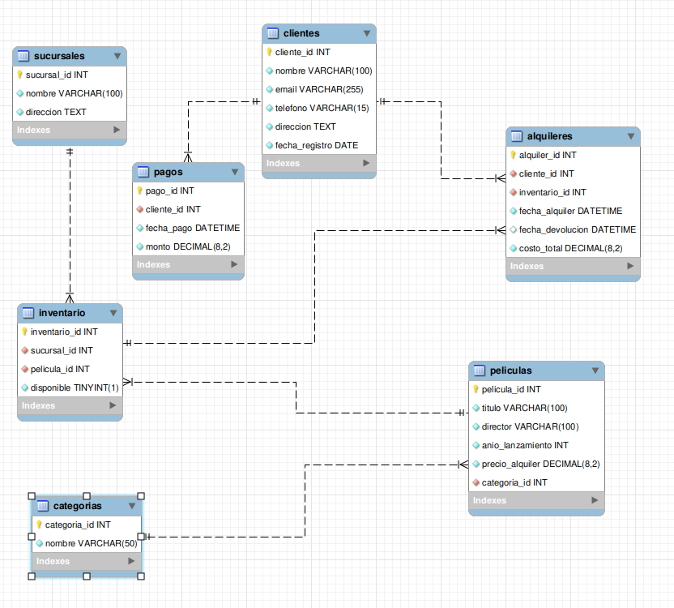

MOVIERENTAL - Sistema de Gestión de Alquiler de Películas

## Descripción General
MOVIERENTAL es una solución de base de datos relacional diseñada sobre PostgreSQL para gestionar operaciones de alquiler de películas, inventario entre sucursales, registro de clientes y control de pagos. El sistema se encuentra normalizado hasta la Tercera Forma Normal (3FN) como lo solicita en las instrucciones.

## Diagrama Simple 

```
[ SUCURSALES ] 1 <--- N [ INVENTARIO ]
                                | 1
                                |
                                v N

                        [ PELICULAS ] N ---> 1 [ CATEGORIAS ]
                                                        | 1
                                                        |
                                                        v N
                        [ CLIENTES ] 1 <----------- [ ALQUILERES ]
                            | 1                         
                            |                           
                            v N                         
                        [ PAGOS ]                       

```

## Diagrama Modelo E-R.



## Instrucciones de Ejecución

1. **Crear la base de datos:**
```bash
CREATE DATABASE movierental;
```


2. **Ingresar a la base de datos:**
```bash
\¢ movierental;
```

3. **Importar estructuras y datos (en el siguiente orden de manera riguirosa):**
```bash
psql -d movierental_db -f db.sql
psql -d movierental_db -f insert.sql
psql -d movierental_db -f transaccion.sql

```


4. **Ejecutar consultas de prueba:**
Estas se encuentran en el archivo 
```bash
querys.sql
```


## Explicación del Procedimiento Almacenado

El procedimiento `registrar_pago(p_cliente_id, p_monto)` maneja transacciones atómicas garantizando la integridad de los datos:

* Valida que `p_monto` sea estrictamente mayor a 0.
* Verifica la existencia del cliente mediante consulta directa a la tabla `clientes`.
* Si se detecta un error de validación, lanza una excepción que revierte automáticamente la transacción (`ROLLBACK`).
* Si las validaciones son exitosas, inserta el registro y confirma los cambios (`COMMIT`).

Ejemplo de uso:

```sql
CALL registrar_pago(1, 15.50); -- Caso exitoso
CALL registrar_pago(99, 10.00); -- Falla: Cliente inexistente (ROLLBACK)
CALL registrar_pago(1, -5.00);  -- Falla: Monto inválido (ROLLBACK)

```
